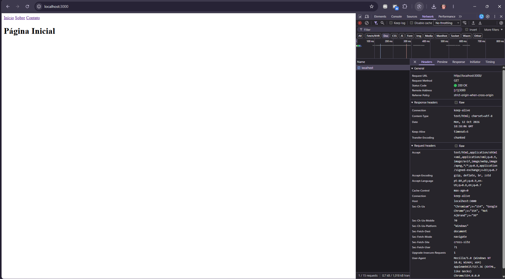
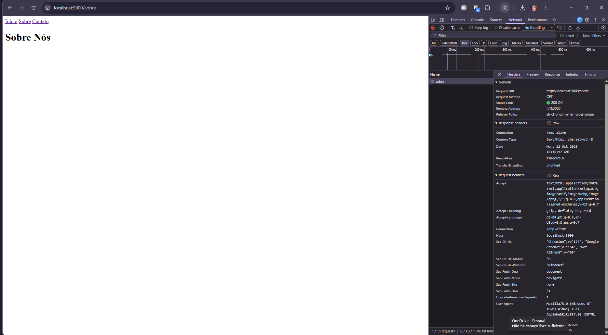
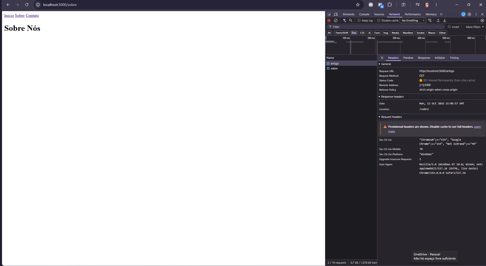
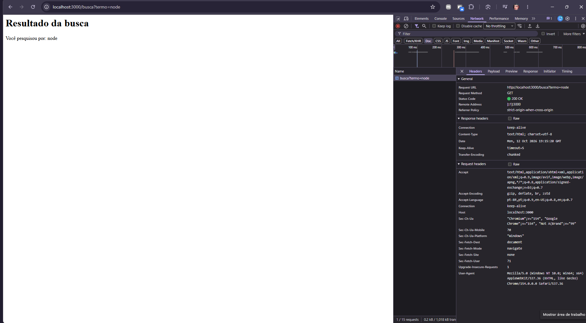
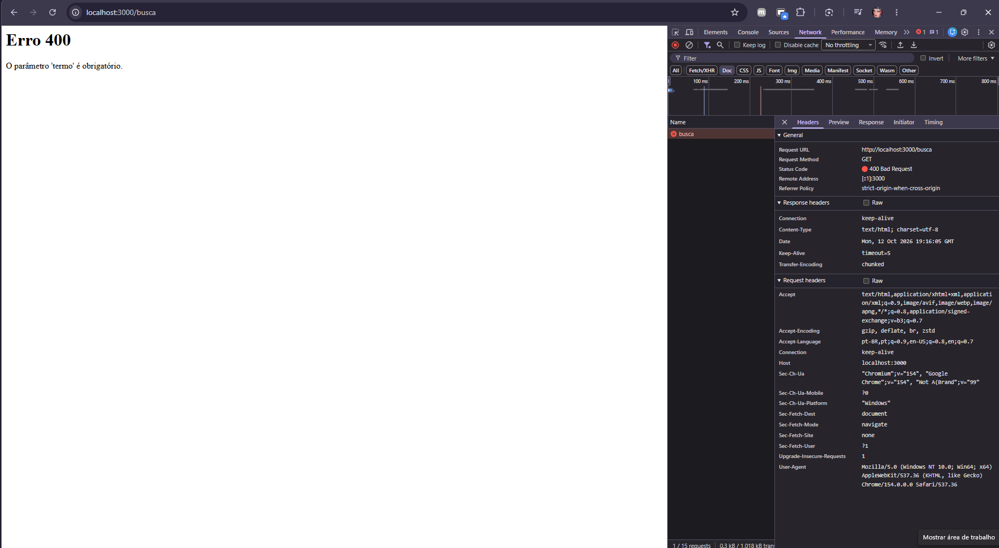
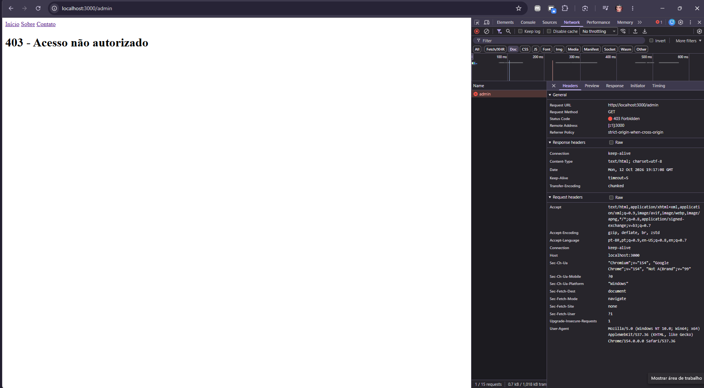
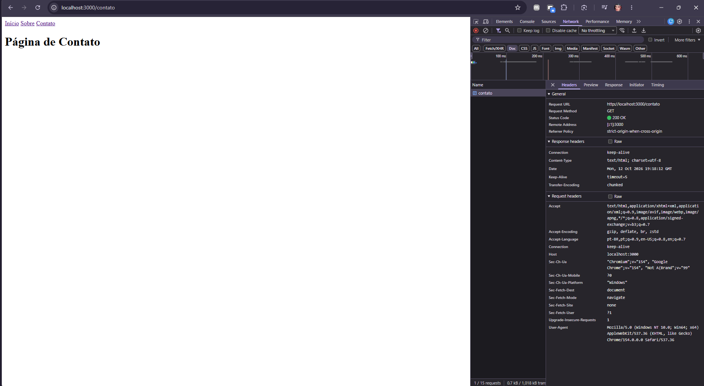
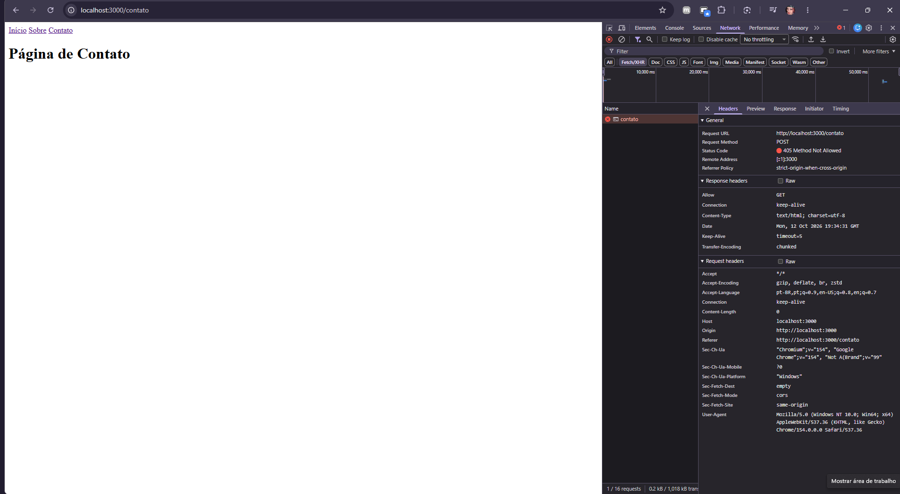
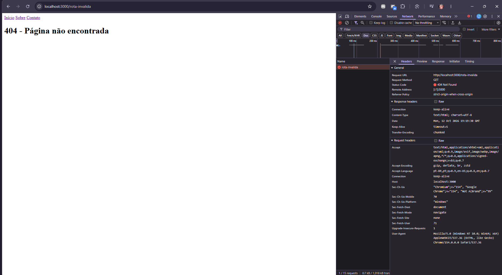

# Fundamentação Teórica

## 1. Cliente e Servidor

O protocolo HTTP permite a troca de dados na web entre duas partes: o cliente, geralmente o navegador e o servidor, onde a aplicação está hospedada. No modelo cliente-servidor, o cliente envia uma requisição solicitando recursos (como as páginas HTML, imagens ou os dados) e aguarda a resposta do servidor.

Para que essa comunicação aconteça, temos o DNS (Domain Name System). Originalmente, os servidores são localizados na rede através de endereços numéricos chamados IPs. Como seria difícil memorizar esses números, o DNS atua como um tradutor: ele pega o nome em texto digitado no navegador, o domínio, e o converte no endereço IP correto. Assim, o navegador descobre para qual servidor deve encaminhar a requisição HTTP.

Com o endereço IP localizado, o navegador envia uma requisição HTTP para o servidor solicitando os arquivos da página. Essa troca de dados ocorre através de uma conexão de rede guiada pela arquitetura TCP/IP, um conjunto de protocolos que controla a transmissão das informações. O IP cuida do endereçamento e roteamento para garantir que as mensagens cheguem à máquina certa, enquanto o TCP garante a confiabilidade da entrega, dividindo os dados em pequenos pacotes no envio e reagrupando-os perfeitamente ao chegarem ao destino.

Assim que o servidor recebe e processa esse pedido, ele retorna uma resposta HTTP com o status da operação junto aos arquivos da página, permitindo que o navegador renderize o site final na tela.

## 2. Anatomia da Requisição e da Resposta

Tanto a requisição (enviada pelo navegador) quanto a resposta (devolvida pelo servidor) são mensagens de texto estruturadas em três partes principais: **linha inicial**, **cabeçalhos** e **corpo**.

### Requisição HTTP (Cliente → Servidor)
```http
GET / HTTP/1.1
Host: localhost:3000
User-Agent: Mozilla/5.0 (Windows NT 10.0; Win64; x64) AppleWebKit/537.36 (KHTML, like Gecko) Chrome/154.0.0.0 Safari/537.36
Accept: text/html,application/xhtml+xml,application/xml;q=0.9,image/avif,image/webp,image/apng,*/*;q=0.8

- **Linha Inicial (Request Line):** `GET / HTTP/1.1` informa o método HTTP (`GET`), o caminho solicitado (`/`) e a versão do protocolo (`HTTP/1.1`).
- **Cabeçalhos:** `Host`, `User-Agent` e `Accept` enviam metadados sobre quem está fazendo a requisição e quais formatos o navegador aceita.
- **Corpo:** Vazio nesta requisição, pois o método `GET` serve apenas para buscar dados.

### Resposta HTTP (Servidor → Cliente)

**HTTP**

```HTTP/1.1 200 OK
Connection: keep-alive
Content-Type: text/html; charset=utf-8
Date: Mon, 12 Oct 2026 18:38:06 GMT
Keep-Alive: timeout=5
Transfer-Encoding: chunked
```

**HTML**

```<!DOCTYPE html>
<html lang="pt-br">
<head>
    <meta charset="UTF-8">
    <meta name="viewport" content="width=device-width, initial-scale=1.0">
    <title>Início</title>
</head>
<body>
    <nav>
        <a href="/">Início</a>
        <a href="/sobre">Sobre</a>
        <a href="/contato">Contato</a>
    </nav>
    <h1>Página Inicial</h1>
</body>
</html>
```

- **Linha Inicial:** `HTTP/1.1 200 OK` — informa a versão do protocolo, o código de status (`200`) e a mensagem de sucesso (`OK`).
- **Cabeçalhos:** `Content-Type: text/html; charset=utf-8` e `Content-Length` especificam a codificação do documento e seu tamanho em bytes.
- **Corpo:** Conteúdo HTML completo gerado pela função `homePage()` e a função utilitária `layout()`.

## 3. Métodos HTTP

O protocolo HTTP define um conjunto de métodos de requisição responsáveis por indicar a ação a ser executada em um determinado recurso. Temos 9 métodos ao total, mas, esses são os 5 mais usados:

- **GET:** ele irá buscar dados, coletar informações. E requisições utilizando o método GET devem retornar apenas dados. E até que atualizamos algum registro, o GET nunca pode haver mudanças.
- **POST:** cria novos registros ou adiciona uma nova informação a um objeto correlacionado.
- **PUT:** atualiza registros ao invés de criar um novo.
- **PATCH:** realiza uma atualização parcial em um recurso existente.
- **DELETE:** remove um recurso específico do servidor.

### Propriedades dos Métodos

- **Método seguro:** é aquela execução que é somente de leitura, ou seja, não altera nem modifica o estado dos dados no banco ou servidor. O GET é o principal exemplo de método seguro.
- **Método idempotente:** é aquele que produz exatamente o mesmo resultado no servidor, não importa quantas vezes seja executado consecutivamente com os mesmos dados. Os métodos GET, PUT e DELETE são idempotentes. O POST não é idempotente, pois disparar 3 requisições POST idênticas pode criar 3 registros repetidos no banco de dados.

## 4. Códigos de Status HTTP

Os códigos de status são números retornados pelo servidor para indicar o resultado do processamento da requisição.

- **1xx - Informativo:** a requisição foi recebida e o processo continua em andamento.
- **2xx - Sucesso:** a requisição foi recebida, compreendida e processada com êxito.
- **3xx - Redirecionamento:** o cliente precisa realizar ações adicionais (como acessar outra URL) para concluir a requisição.
- **4xx - Erro do Cliente:** a requisição contém dados inválidos, falha de autenticação ou solicitação de algo inexistente.
- **5xx - Erro do Servidor:** o servidor falhou ao tentar processar uma requisição válida devido a um erro interno.

### Significado dos Códigos

- **200 OK:** requisição bem-sucedida. O recurso foi retornado ou alterado com sucesso.
- **201 Created:** o pedido teve sucesso e resultou na criação de um novo recurso no servidor.
- **301 Moved Permanently:** o recurso buscado mudou de endereço de forma definitiva. O navegador salva essa nova URL em cache para acessos futuros.
- **302 Found:** o recurso mudou de endereço de forma temporária. O navegador redireciona agora, mas continuará buscando a URL original em futuras requisições.
- **304 Not Modified:** indica que o recurso não sofreu alterações desde a última consulta. O navegador pode usar a cópia mantida em seu cache local, economizando tráfego de rede.
- **400 Bad Request:** a requisição possui sintaxe inválida ou dados incorretos que o servidor não conseguiu interpretar.
- **401 Unauthorized:** o usuário não está autenticado. Falta de credenciais válidas.
- **403 Forbidden:** o usuário está autenticado, mas não possui permissão/autorização para acessar aquele recurso específico.
- **404 Not Found:** o recurso ou rota solicitada não foi encontrado no servidor.
- **405 Method Not Allowed:** o método HTTP utilizado não é permitido para a rota acessada.
- **500 Server Error:** ocorreu um erro genérico no código do servidor ou no banco de dados que impediu a conclusão do pedido.

### Diferenças Notáveis

#### Diferença entre 401 e 403

- **401 Unauthorized:** o sistema não sabe quem é o usuário porque ele não fez login ou não enviou um token válido.
- **403 Forbidden:** o sistema sabe quem é o usuário, mas o perfil dele não tem direito de acesso, como um usuário comum tentando acessar `/admin`.

#### Diferença entre 301 e 302

- **301 Moved Permanently:** o redirecionamento é permanente. Os navegadores guardam em cache a nova rota e nas próximas vezes nem consultam mais a URL antiga.
- **302 Found:** o redirecionamento é temporário. Nas próximas vezes, o navegador continuará chamando a URL original porque a alteração pode voltar ao normal.

## 5. Cabeçalhos HTTP

Os cabeçalhos HTTP permitem que o cliente e o servidor passem informações adicionais com a solicitação ou a resposta HTTP. Eles não carregam os dados principais da página ou do banco, mas sim instruções de contexto sobre como essa mensagem deve ser tratada, interpretada, armazenada ou protegida.

- **Content-Type:** informa ao destinatário qual é o formato exato do dado retornado ou enviado no corpo da mensagem. Como por exemplo `text/html` (para páginas web).
- **Content-Length:** indica o tamanho exato do corpo da mensagem medido em bytes. Permite que quem está recebendo saiba quando o download do corpo terminou.
- **User-Agent:** enviado pelo cliente para identificar qual aplicação, sistema operacional, arquitetura e versão de navegador está fazendo a requisição.
- **Accept:** enviado pelo cliente para informar ao servidor quais formatos de resposta ele é capaz de processar.
- **Location:** utilizado pelo servidor em respostas de redirecionamento para indicar a nova URL para onde o cliente deve ir.
- **Allow:** enviado pelo servidor para informar ao cliente quais métodos HTTP aquela rota específica aceita.
- **Cache-Control:** define as políticas e regras de armazenamento em cache para o navegador.

## 6. HTTP é Stateless

O HTTP ser stateless significa que ele não guarda histórico. Cada requisição é tratada pelo servidor de forma isolada e independente, sem lembrar das chamadas anteriores.

Esse funcionamento foi projetado para garantir alta escalabilidade e desempenho, já que o servidor não gasta memória nem processamento mantendo conexões ativas com os clientes.

Para que os sistemas consigam manter ações contínuas, como um usuário logado, são enviados identificadores em todas as requisições, através dos cookies, sessões ou tokens.

## 7. HTTP vs. HTTPS

O HTTP é um protocolo padrão para transmissão de dados, só que de forma simples. Mas ele não é seguro. Já o HTTPS utiliza criptografia dos dados que serão transmitidos, garantindo que a comunicação entre o servidor e cliente seja segura e privada.

## Evidências de Funcionamento

### Capturas de Ecrã do DevTools (Aba Network)

#### 1. Rota `/` (Página Inicial)

*A captura mostra a resposta da rota principal com o código de status 200 OK e o cabeçalho Content-Type configurado como text/html; charset=utf-8.*

#### 2. Rota `/sobre`

*A captura mostra a requisição bem-sucedida para a rota /sobre, retornando o código de status 200 OK e a estrutura HTML correspondente.*

#### 3. Rota `/antigo` (Redirecionamento)

*A captura mostra o status de redirecionamento permanente 301 Moved Permanently e o cabeçalho Location direcionando o navegador para /sobre.*

#### 4. Rota `/busca?termo=node` (Busca com Parâmetro)

*A captura mostra o retorno do status 200 OK processando com sucesso o parâmetro "termo=node" enviado na URL.*

#### 5. Rota `/busca` (Busca sem Parâmetro)

*A captura mostra o erro de cliente 400 Bad Request retornado ao aceder à rota de busca sem fornecer o parâmetro obrigatório "termo".*

#### 6. Rota `/admin` (Acesso Negado)

*A captura mostra a resposta com status 403 Forbidden, bloqueando o acesso à rota administrativa.*

#### 7. Rota `/contato` com método GET

*A captura mostra o acesso bem-sucedido à página de contato via método GET com status 200 OK.*

#### 8. Rota `/contato` com método POST

*A captura mostra a resposta 405 Method Not Allowed e o cabeçalho Allow: GET ao tentar enviar uma requisição POST.*

#### 9. Rota Inexistente (`/rota-invalida`)

*A captura mostra o tratamento de rotas não encontradas retornando o status 404 Not Found.*

---

### Testes via Terminal (Comando `curl -i`)

#### 1. Redirecionamento da rota `/antigo`

```
curl -i http://localhost:3000/antigo

```

**Saída obtida no terminal:**

```
HTTP/1.1 301 Moved Permanently
Location: /sobre
Date: Mon, 12 Oct 2026 19:56:23 GMT
Connection: keep-alive
Keep-Alive: timeout=5
Transfer-Encoding: chunked

```

#### 2. Validação da rota `/busca` sem parâmetro

```
curl -i http://localhost:3000/busca

```

**Saída obtida no terminal:**

```
HTTP/1.1 400 Bad Request
Content-Type: text/html; charset=utf-8
Date: Mon, 12 Oct 2026 19:56:54 GMT
Connection: keep-alive
Keep-Alive: timeout=5
Transfer-Encoding: chunked

<h1>Erro 400</h1><p>O parâmetro 'termo' é obrigatório.</p>

```

#### 3. Teste do método não permitido em `/contato`

```
curl -i -X POST http://localhost:3000/contato

```

**Saída obtida no terminal:**

```
HTTP/1.1 405 Method Not Allowed
Content-Type: text/html; charset=utf-8
Allow: GET
Date: Mon, 12 Oct 2026 19:57:45 GMT
Connection: keep-alive
Keep-Alive: timeout=5
Transfer-Encoding: chunked

<h1>405 Método Não Permitido</h1>

```

## Referências

- Uma visão geral do HTTP - HTTP | MDN. Disponível em:[ https://developer.mozilla.org/pt-BR/docs/Web/HTTP/Guides/Overview](https://developer.mozilla.org/pt-BR/docs/Web/HTTP/Guides/Overview). Acesso em: 8 out. 2026.
- Como a Web funciona - Aprendendo desenvolvimento web | MDN. Disponível em:[ https://developer.mozilla.org/pt-BR/docs/Learn_web_development/Getting_started/Web_standards/How_the_web_works](https://developer.mozilla.org/pt-BR/docs/Learn_web_development/Getting_started/Web_standards/How_the_web_works). Acesso em: 8 out. 2026.
- RAFAELLA BALLERINI. Como funcionam a INTERNET e a WEB? Finalmente entenda da forma mais didática possível! YouTube, 13 ago. 2024. Disponível em:[ https://www.youtube.com/watch?v=A-hNZjcaS-Q](https://www.youtube.com/watch?v=A-hNZjcaS-Q). Acesso em: 8 out. 2026.
- GAME DEV COM JUAN. Domine os Métodos HTTP: GET, POST, PUT, PATCH e DELETE [Guia Completo]. YouTube, 13 abr. 2024. Disponível em:[ https://www.youtube.com/watch?v=287AhcajfyU](https://www.youtube.com/watch?v=287AhcajfyU). Acesso em: 8 out. 2026.
- BYTEBYTEGO. HTTP Status Codes Explained In 5 Minutes. Disponível em:[ https://www.youtube.com/watch?v=qmpUfWN7hh4](https://www.youtube.com/watch?v=qmpUfWN7hh4). Acesso em: 11 out. 2026.
- HASHTAG PROGRAMAÇÃO. Status de Códigos HTTP - Explicação Completa. YouTube, 12 set. 2023. Disponível em:[ https://www.youtube.com/watch?v=FmtYCZFuIn4](https://www.youtube.com/watch?v=FmtYCZFuIn4). Acesso em: 11 out. 2026.
- Códigos de status de respostas HTTP - HTTP | MDN. Disponível em:[ https://developer.mozilla.org/pt-BR/docs/Web/HTTP/Reference/Status](https://developer.mozilla.org/pt-BR/docs/Web/HTTP/Reference/Status). Acesso em: 11 out. 2026.
- ROCKETSEAT. Desvendando Requisições HTTP: Métodos, Parâmetros, Body e Status Codes para Devs. YouTube, 1 out. 2025. Disponível em:[ https://www.youtube.com/watch?v=bMmdksBHyXc](https://www.youtube.com/watch?v=bMmdksBHyXc). Acesso em: 11 out. 2026.
- Cabeçalhos HTTP - HTTP | MDN. Disponível em:[ https://developer.mozilla.org/pt-BR/docs/Web/HTTP/Reference/Headers](https://developer.mozilla.org/pt-BR/docs/Web/HTTP/Reference/Headers). Acesso em: 11 out. 2026.

## Declaração de Uso de IA

GOOGLE. Gemini (modelo 1.5 Flash). Ferramenta de inteligência artificial generativa.

Data de uso: 12 out. 2026.

Finalidade: suporte na pesquisa teórica do protocolo HTTP, validação das rotas, orientação na coleta de evidências (DevTools e curl) e formatação final do README.md. 

Arquivos impactados: `README.md, src/routes.js`;
